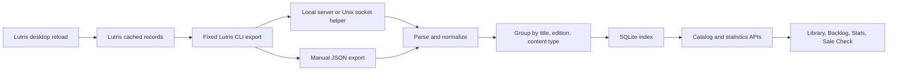

# Architecture and maintenance

My Game Library is a local, read-only browser over Lutris's cached ownership records. It writes only its own index. It does not synchronize storefront accounts or manage games. Start with [README.md](README.md) for operation, [CONTRIBUTING.md](CONTRIBUTING.md) for checks, and [SECURITY.md](SECURITY.md) for deployment boundaries.

## Data flow

Opening a page reads the existing index. Only an explicit refresh or rebuild reads the configured source. Reloading a store in Lutris updates its cache; it does not notify the web app. Rebuilding the web index cannot discover purchases missing from that cache or a manual export.

## Where to make changes

| Area | Files and responsibilities |
| --- | --- |
| Server pages and APIs | `src/app/`: initial page data, bounded query parameters, refresh/rebuild request guards |
| UI and fetching | `src/components/`: screens, artwork fallbacks, detail ledger, shared pagination hook |
| Source selection | `src/lib/lutris/client.ts`: fixed CLI commands, import file/helper priority, process-wide update lock |
| Import validation | `src/lib/lutris/parser.ts`: validate the top-level export; tolerate nested details as JSON strings or objects |
| Provider fields | `src/lib/lutris/normalizer.ts`: provider aliases, units, dates, images, optional metadata |
| Identity and grouping | `src/lib/lutris/matching.ts`: Unicode title normalization, edition and DLC separation |
| Persistence and queries | `src/lib/lutris/database.ts`: SQLite lifecycle, migration, transactions, FTS, filters and pagination |
| Shared contracts | `src/lib/lutris/types.ts` and `services.ts`: payload types and provider names/IDs |
| Statistics | `src/lib/lutris/stats.ts`: ownership counts, edition groups, title-based franchise suggestions |
| Host integration | `scripts/host-bridge.mjs`, `scripts/install-host-bridge.mjs`, and `src/lib/lutris/host.ts` |
| Distribution | `Dockerfile`, Compose files, `scripts/package-notices.mjs`, and `.github/workflows/ci.yml` |
| Design | [DESIGN.md](DESIGN.md), [PRODUCT.md](PRODUCT.md), and `src/app/globals.css` |

## Import contracts and missing metadata

`LutrisRecord` is untrusted provider-shaped input. `LibraryGame` is one normalized store ownership record. `LibraryGameGroup` is one browsable edition containing every matching ownership record and a `primary` record for display defaults.

The parser accepts an array or an object containing a `games` array. Blank output, malformed JSON, and invalid records fail before persistence. An explicit empty array is valid and intentionally clears the index. Malformed nested `details` stays available as raw text instead of discarding the entire game.

Dates normalize to ISO UTC strings, accepting provider timestamps in seconds or milliseconds. Playtime is in minutes. An absent value means unknown; it must not be converted into a verified zero. Native Linux support likewise distinguishes unknown from explicit false. Real playtime currently comes only from supported Steam fields. The tested Epic and GOG exports have no playtime; Lutris's local-game hours are a different source and are not merged.

`rawDetails` is retained in SQLite and returned for the advanced metadata ledger. It is not a redacted public payload. Treat the database, API responses, exports, and screenshots as private library data. Tests and published captures must use synthetic fixtures.

## Source selection and failure behavior

Demo mode uses illustrative records in an in-memory database. Otherwise source priority is:

1. `LUTRIS_HOST_SOCKET`: request a fresh export from the fixed helper endpoint.
2. `LUTRIS_IMPORT_FILE`: read the configured JSON file.
3. Local CLI: `lutris --list-all-service-games --json`, then `lutris -a -j` as a compatibility fallback if the primary command fails.

A configured helper failure is surfaced; it does not fall back to a potentially stale file. Browser requests never choose a path, executable, or arguments. Source environment variables are server configuration. Database paths are read at module initialization, so restart the server after changing them.

The host helper exposes only `POST /refresh` over an owner/group-accessible Unix socket. It rejects bodies and browser-originated requests, bounds export time/output, and prevents concurrent exports. Its command timeout is 60 seconds; the web client's 65-second limit gives the helper time to return its own error. Each request uses a fresh connection so restarting the helper does not retain a stale pooled socket.

The helper runs as the desktop user, outside Docker's isolation. The container receives only its socket directory, not a host executable or Docker socket. Socket-group members must be trusted to request private library exports. Account login and store reload remain Lutris desktop responsibilities.

## SQLite lifecycle

Node's synchronous SQLite API serves this small local index. A process-global connection survives server module reloads. Production persists to the configured path; demo mode stays in memory. WAL mode supports normal reads around transactional writes.

The `games` table holds normalized ownership payloads. `library_groups` stores grouped payloads and derived sort/filter columns. Two FTS5 tables separate full metadata search from title-only Sale Check searches. `metadata` records initialization, refresh time, entry count, and derived-index version.

Refresh replaces ownership records, groups, both search indexes, and metadata in one transaction. A failure rolls back the complete replacement. The process-wide update lock spans asynchronous source reads too, preventing an older export from finishing after and overwriting a newer one.

Rebuild prepares a database beside the existing file, completes its transaction, checkpoints/closes it, then renames it over the old index. Building on the same filesystem allows the final rename. Failure before replacement leaves the old index available. Temporary databases and journal files are cleaned up. Demo rebuild swaps in-memory connections instead.

Run one server process per database path. The JavaScript lock and connection singleton do not coordinate multiple processes or replicas. `resetDatabase()` is destructive maintenance used by tests; browser recovery uses the safer rebuild path.

Older JSON caches are imported only into an uninitialized index. Derived-index version 2 can regroup stored records without contacting Lutris. Title-search backfill also uses stored payloads. When changing grouping or derived columns, consider migration/versioning and preservation tests as well as fresh imports.

## Grouping, queries, and counts

Grouping normalizes accents, punctuation, and whitespace while retaining Unicode letters and numbers. Identity includes base title, edition, and game/DLC status. Distinct editions and add-ons remain separate. Provider IDs are not globally unique; internal snapshot keys combine group identity and record position and are not stable IDs across imports.

The primary record favors artwork, installation, then playtime. It does not replace ownership records. Grouped playtime uses the maximum supplied duration, not the sum of store copies. Statistics distinguish raw entry totals from unique editions; title-token franchise suggestions are heuristics, not authoritative metadata.

Catalog search combines quoted token prefixes with AND. It is not arbitrary FTS syntax or a substring search. User values are bound SQL parameters; table names and sort clauses are selected from fixed code. A service filter matches any ownership record and still returns the entire group. Installation/Linux flags can likewise be satisfied by any record in that group.

Pagination applies after filtering and sorting. Page numbers are bounded to 1–1,000,000 and page size to 12–100. Response `total` counts matching editions; `entryCount`, `uniqueCount`, and header service counts describe the whole catalog, independently of active filters. Service counts count distinct editions per service, so they can sum to more than the unique catalog total.

Playtime bands use minutes: 2 hours is 120, 10 is 600, 50 is 3,000, and 100 is 6,000. Backlog's `never` and `under2-inclusive` filters include unknown values; the main catalog's `under2` requires a known positive duration. Backlog display currently treats unknown as zero too. This is a documented browsing convention, not proof of no prior playtime.

## Browser state and accessibility

`usePaginatedLibrary` shares fetching across Library, Backlog, and Sale Check. It tracks requested criteria separately from successfully loaded criteria. Filter changes abort obsolete requests, and a criteria check also rejects responses that win a completion/abort race. A ref prevents duplicate load-more requests before React commits its loading state.

Refresh/rebuild re-fetch page one using the latest criteria, even if filters changed while the mutation was running. Server-rendered initial data must be paired with the same `initialCriteria`; otherwise the hook can mistake the initial page for another filter's result.

The details ledger is inline on desktop. An explicitly opened mobile ledger becomes a dialog with focus trapping, Escape handling, scroll locking, and focus restoration; automatic initial selection does not open a modal. Keep these behaviors when changing layouts. The indexed timestamp hydrates using a deterministic UTC label before switching to browser-local formatting, avoiding server/browser locale mismatches.

## API surface

| Endpoint | Contract |
| --- | --- |
| `GET /api/library` | Returns `LibraryPagePayload`; supports `LibraryQuery` filters, sorting, pagination, and title/all search scope. Unknown enum values fall back to defaults. |
| `GET /api/stats` | Returns `LibraryStatsPayload` derived from the cached normalized records. |
| `POST /api/library/refresh` | Imports the configured source; returns refresh time and raw entry count. |
| `POST /api/library/rebuild` | Rebuilds from the configured source; returns refresh time and raw entry count. |

Read responses disable caching. Mutation routes reject cross-origin browser requests with 403; source/update failures return 503 with an error message. Headerless local CLI requests remain supported. Origin/Fetch Metadata checks prevent browser request forgery; they do not provide authentication. Never expose the unauthenticated application to an untrusted network.

## Extending and verifying the code

For a new provider or schema change, begin with a small synthetic export fixture. Update service aliases/catalog, field normalization, relevant shared types, and provider parsing tests. Check grouping, SQLite service filters/counts, and statistics through an import rather than relying only on a UI label. Do not invent unavailable fields or add account-token handling to this import path.

For query/storage changes, cover boundaries, duplicate ownership, unknown metadata, failed-update preservation, and existing-index migration where relevant. For UI fetching changes, check rapid filter changes, returning to a loaded filter, refresh with filters active, and pagination. Test desktop/mobile keyboard behavior for visible changes.

Run the checks in [CONTRIBUTING.md](CONTRIBUTING.md). Production smoke tests start the built standalone server with isolated synthetic data, exercise both file and helper modes, and verify packaged runtime licenses. Build scripts collect installed dependency notices alongside the server. Docker copies this standalone output plus static/public assets and runs as a non-root user with a read-only root filesystem under Compose.

Comment invariants, units, trust boundaries, and failure/recovery decisions near the code that implements them. Keep this guide and README aligned when contracts change; straightforward rendering and assignments do not need line-by-line narration.
