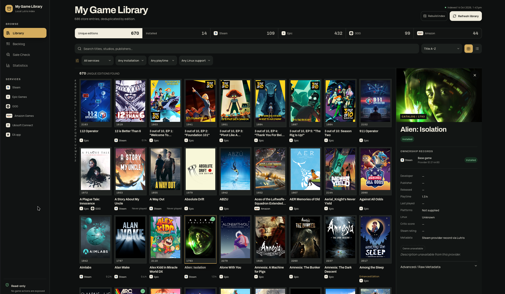
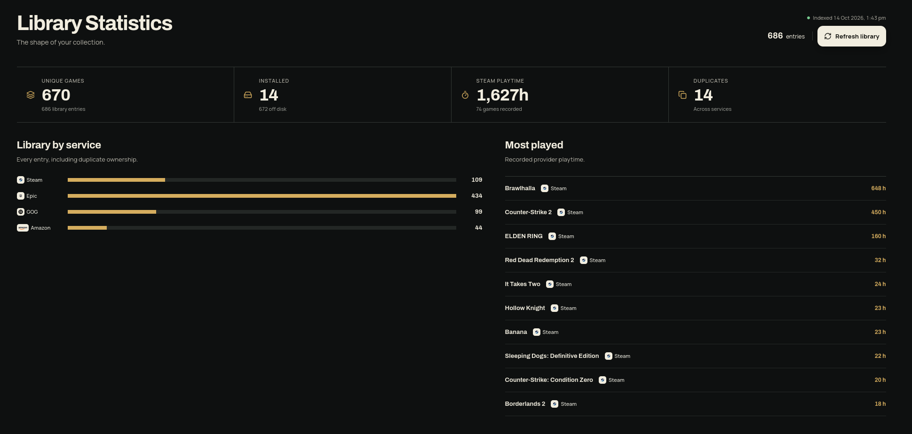
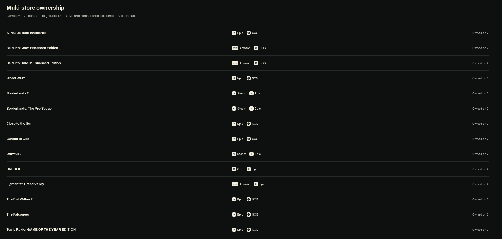
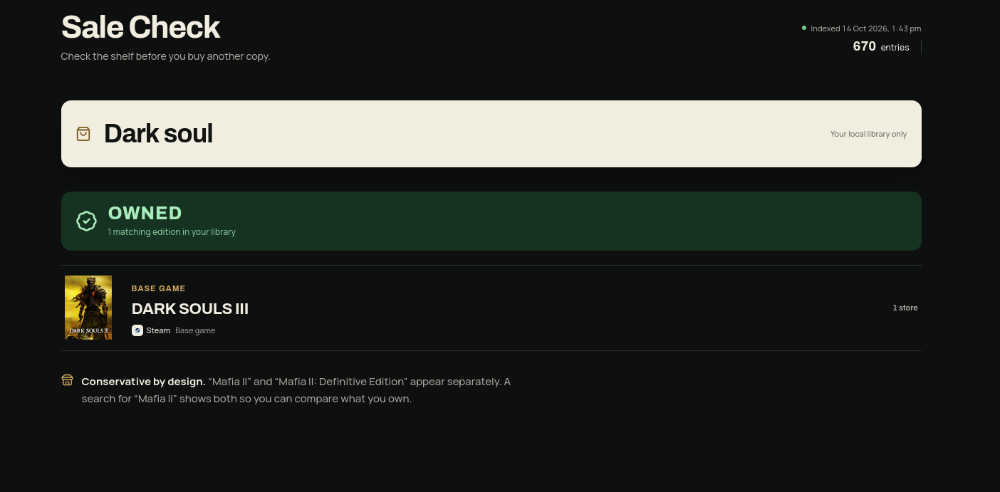

# My Game Library

A local-first, read-only web browser for game libraries connected to [Lutris](https://lutris.net/). Browse Steam, Epic Games, GOG, Amazon Games, Ubisoft Connect, and EA app ownership from one searchable interface without exposing game-management actions.

> Early release. Provider exports change over time; malformed or missing metadata should degrade gracefully, but some fields may be unavailable.

## Screenshots



Browse your collection across stores, filter the catalog, and inspect ownership records in the side panel.

<details>
<summary>More screenshots: statistics, multi-store ownership, and Sale Check</summary>

**Library statistics** — Service totals, recorded Steam playtime, and your most-played games.



**Multi-store ownership** — See which games you own on more than one service while keeping distinct editions separate.



**Sale Check** — Search the local index before buying another copy.



</details>

## Features

- Deduplicates equivalent games across stores while keeping distinct editions and DLC separate.
- Searches titles, developers, publishers, and available genre metadata.
- Filters by service, installation, playtime, and Linux support.
- Sorts by title, dates, playtime, last played, critic score, Steam rating, and service.
- Includes grid/list browsing, backlog, statistics, and an edition-aware Sale Check.
- Guides first-run setup, provides resilient artwork fallbacks, and exposes provider metadata in a game ledger.
- Can safely rebuild only the local SQLite index after import or schema problems.
- Stores normalized data locally in SQLite with full-text search and indexed filters.
- Executes only predefined Lutris commands; the browser cannot submit commands or file paths.

## Requirements

- Node.js 24 or newer
- pnpm 10.17.1
- Lutris in `PATH` for local refreshes or the optional host helper
- Docker with Compose support for container use

## Quick start

Preview with illustrative data; Lutris is not required:

```bash
git clone https://github.com/ShivWad/lutris-web.git
cd lutris-web
pnpm install
LUTRIS_DEMO=1 pnpm dev
```

Open <http://127.0.0.1:5000>.

## How library updates work

1. Sign in to each store in the Lutris desktop app and let its game list load.
2. After buying or claiming more games, use **Reload** for the affected store in Lutris and wait for it to finish.
3. Choose **Refresh library** in this web app. With manual Docker imports, replace the export file first.

`lutris --list-all-service-games --json` lists records already cached by Lutris. It does not synchronize storefront accounts. This app and the optional helper do not call store APIs or manage login tokens. The same workflow applies to Steam, Epic Games, GOG, Amazon Games, Ubisoft Connect, and EA app.

**Rebuild index** recreates only the web app's SQLite index from its configured source. It cannot discover purchases missing from Lutris or an old export file. If games are missing, reload the store in Lutris, clear the web app's filters, and refresh again.

## Metadata and playtime

Metadata depends on the fields supplied by Lutris and each provider; missing values are not fetched from another service.

| Source | Playtime in real imports |
| --- | --- |
| Steam | Imported when the provider record includes `playtime_forever` or `playtime`, in minutes. |
| Epic Games and GOG | Their service exports on the tested Lutris installation contain no playtime fields. Launcher-wide totals are unavailable through this import. |
| Other services | No playtime normalization is implemented yet. |

Refreshing or rebuilding cannot add absent playtime. Lutris's separately tracked local-game hours are not merged into service records. Missing playtime means unknown; the **Never played** and **Under 2 hours** backlog filters currently include unknown values, so they do not prove a game has never been played. Use the Steam service filter when relying on imported playtime.

Release dates, genres, Linux support, descriptions, and ratings can also be missing. Demo mode includes synthetic metadata and does not establish which fields a real provider supplies.

## Use your local Lutris library

```bash
pnpm install
pnpm dev
```

Open <http://127.0.0.1:5000>, then choose **Refresh library**. Refresh runs `lutris --list-all-service-games --json`, with `lutris -a -j` as a compatibility fallback.

Normalized data is stored in `data/library.sqlite` using SQLite WAL mode. An older `data/library-cache.json` is imported once when a new database is created. Local databases and exports are ignored by Git.

## Docker Compose

Lutris runs on the desktop host and is not installed in the container. Export the library before starting or refreshing Docker:

```bash
mkdir -p imports
lutris --list-all-service-games --json > imports/library.json
docker compose up --build
```

Open <http://127.0.0.1:5000>. Compose binds to localhost, stores SQLite in the `library-data` named volume, and mounts `./imports` read-only. The named volume is writable by the container's non-root user without changing host-directory permissions. Replace `imports/library.json`, then choose **Refresh library** to import changes.

### One-click refresh from Docker (Linux)

This option requires Node.js, Lutris in `PATH`, and a systemd user session on the desktop host. Install the host helper once, then start Compose with the host override:

```bash
pnpm host:install
docker compose -f compose.yaml -f compose.host.yaml up --build -d
```

**Refresh library** exports Lutris's cached library and updates the web index directly. After buying or claiming games, reload the affected store in the Lutris desktop app and wait for it to finish, then choose **Refresh library** here. No manual export or container rebuild is needed. The helper only runs the fixed Lutris listing command; it does not contact storefront APIs or read or renew account tokens itself.

The installer writes and enables `lutris-library-bridge.service` in your systemd user session. It starts on login and restarts after a failure. The helper accepts only a fixed export operation over `data/host-bridge/refresh.sock`, mounted into Docker read-only, with no TCP port. Only the socket owner and group can connect. If your host group ID differs from `1000`, set `LUTRIS_HOST_GID` in `.env` to the group ID printed by the installer. Continue using both Compose files when recreating the container. Reinstall the helper after moving this checkout or removing the Node.js version used to install it.

If the helper is unavailable, refresh reports an error and keeps the existing index rather than silently importing an older file. Check or restart it with:

```bash
systemctl --user status lutris-library-bridge.service
systemctl --user restart lutris-library-bridge.service
```

To run it in the foreground instead of installing a service, use `pnpm host:bridge`. To remove the service, run `systemctl --user disable --now lutris-library-bridge.service` and delete `~/.config/systemd/user/lutris-library-bridge.service`. Plain `docker compose up` continues to use manual file imports.

If upgrading from the earlier `./data` bind mount, keep that directory as a backup and choose **Refresh library** to populate the new volume from your export. `docker compose down` preserves the volume; adding `--volumes` deletes the index. Local `pnpm` runs continue to use `./data`.

Run a demo-only container with:

```bash
LUTRIS_DEMO=1 docker compose up --build
```

## Configuration

### Adding another service

Sign in to the service in Lutris, let Lutris load its game list, then choose **Refresh library** here. Every service, including Epic Games, is read from Lutris's local service records. Reload the affected service in Lutris whenever new purchases have not reached that cache. Signing in does not update the web index until you refresh. Ubisoft Connect and EA app have their own labels, filters, and statistics; unrecognized providers are still included under **Other services**. Service totals appear automatically when the refreshed library contains games from that service.

| Variable | Default | Purpose |
| --- | --- | --- |
| `PORT` | `5000` | Published Compose port. |
| `LUTRIS_DEMO` | `0` | Use labeled, in-memory demo data when set to `1`. |
| `LUTRIS_IMPORT_FILE` | `/imports/library.json` in Compose | Read a fixed JSON export instead of invoking Lutris. |
| `LUTRIS_HOST_SOCKET` | Unset; `/host-bridge/refresh.sock` with the host override | Ask the host helper for a fresh export; takes precedence over the import file. |
| `LUTRIS_HOST_GID` | `1000` | Host helper group for Docker socket access with the host override. |
| `LUTRIS_DATA_DIR` | `./data` locally, `/app/data` in Docker | SQLite storage directory. |
| `LUTRIS_DATABASE_PATH` | `<data-dir>/library.sqlite` | Optional explicit SQLite path. |

See [.env.example](.env.example) for Compose overrides.

## Development

```bash
pnpm check:public
pnpm lint
pnpm test
pnpm typecheck
pnpm build
pnpm test:smoke
```

Tests cover provider parsing, normalization, duplicate matching, SQLite queries, failed-update preservation, rebuild recovery, concurrent updates, request guards, and the export-only host helper. Production smoke tests use temporary synthetic libraries to exercise both file-import and helper-socket modes. They do not use store credentials. GitHub Actions runs the same checks on pushes and pull requests.

The production build also packages dependency license notices with the standalone server. `private: true` in `package.json` prevents accidental npm publication; the source is distributed under MIT.

`check:public` checks files in Git's index. Before an initial commit, stage the intended source files and run it again; an empty index is rejected. It checks tracked paths, not Git history or every possible secret value. Review the staged diff and run `pnpm audit` with registry access before publishing. See [RELEASE_CHECKS.md](RELEASE_CHECKS.md) for the latest verification and remaining limitations.

Invalid or incomplete JSON exports are rejected without replacing the index. An explicit `[]` or `{"games":[]}` is a valid empty library. Refresh and rebuild cannot overlap. Rebuild prepares a complete replacement before replacing the old database; use a single application instance per database path. If a damaged database prevents the library from opening, the error screen offers **Rebuild local index**.

Key areas:

- `src/lib/lutris/` — import, normalization, matching, storage, and statistics
- `src/app/api/` — read-only catalog/statistics APIs and explicit refresh endpoint
- `src/components/` — library, backlog, statistics, and Sale Check interfaces

Read [ARCHITECTURE.md](ARCHITECTURE.md) for the data flow, module map, API contracts, index lifecycle, and guidance on extending providers or queries.

## Privacy and security

Library exports can contain account-specific metadata. Never commit `data/`, `imports/library.json`, logs, tokens, or unredacted diagnostic exports. The application binds to `127.0.0.1` by default and has no authentication; do not expose it directly to an untrusted network.

Game covers load from provider CDNs, so those providers can receive ordinary image requests from the browser. See [SECURITY.md](SECURITY.md) for vulnerability reporting.

The helper runs outside Docker as your desktop user. Its restricted socket and fixed command limit its request interface; the helper process is not sandboxed from that user's files. Its code and dependencies must be trusted. Manual file imports do not require a persistent host helper.

## Contributing

Contributions are welcome. Read [CONTRIBUTING.md](CONTRIBUTING.md) and [CODE_OF_CONDUCT.md](CODE_OF_CONDUCT.md) before opening a pull request. Use the issue templates for reproducible bugs and focused feature proposals.

See [CHANGELOG.md](CHANGELOG.md) for release history. Before the first GitHub publication, maintainers should enable private vulnerability reporting and require the CI `verify` check on the default branch. Repository settings are managed on GitHub and are not enabled by these source files.

## License and trademarks

Application code is available under the [MIT License](LICENSE). Provider logos and trademarks are owned by their respective holders and are not licensed under MIT; see [THIRD_PARTY_NOTICES.md](THIRD_PARTY_NOTICES.md).

This community project is not affiliated with or endorsed by Lutris, Valve, Epic Games, GOG, Amazon, Electronic Arts, Ubisoft, or other game publishers and storefronts.
